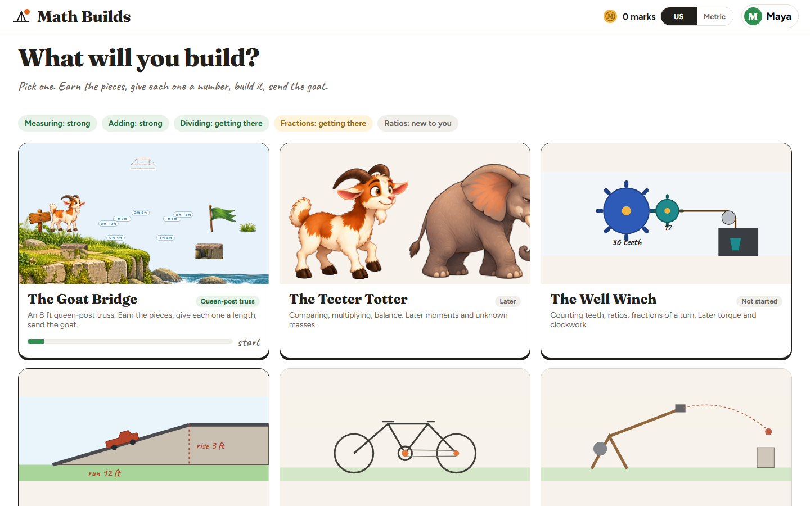
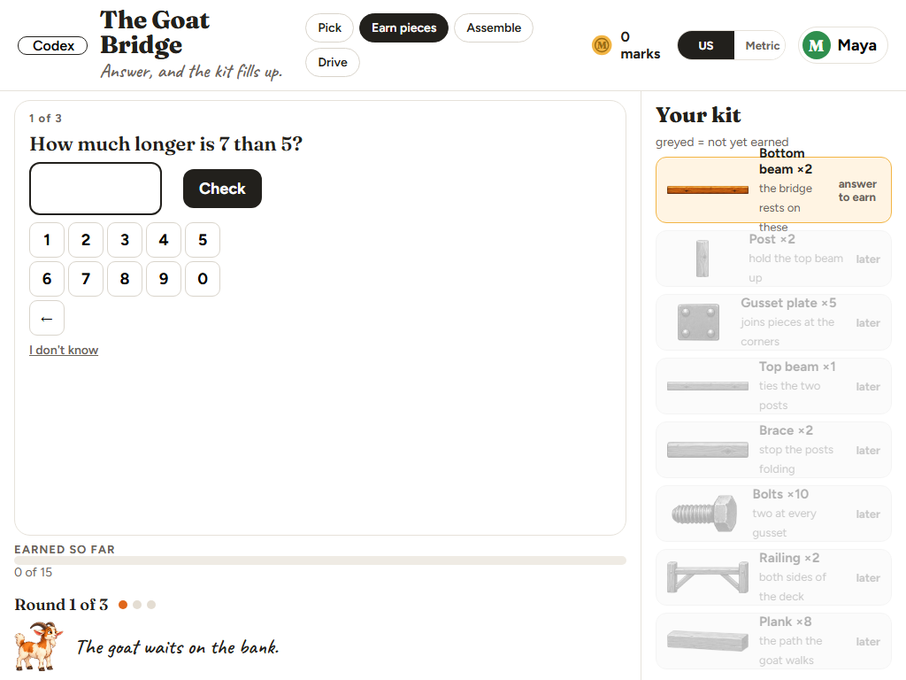
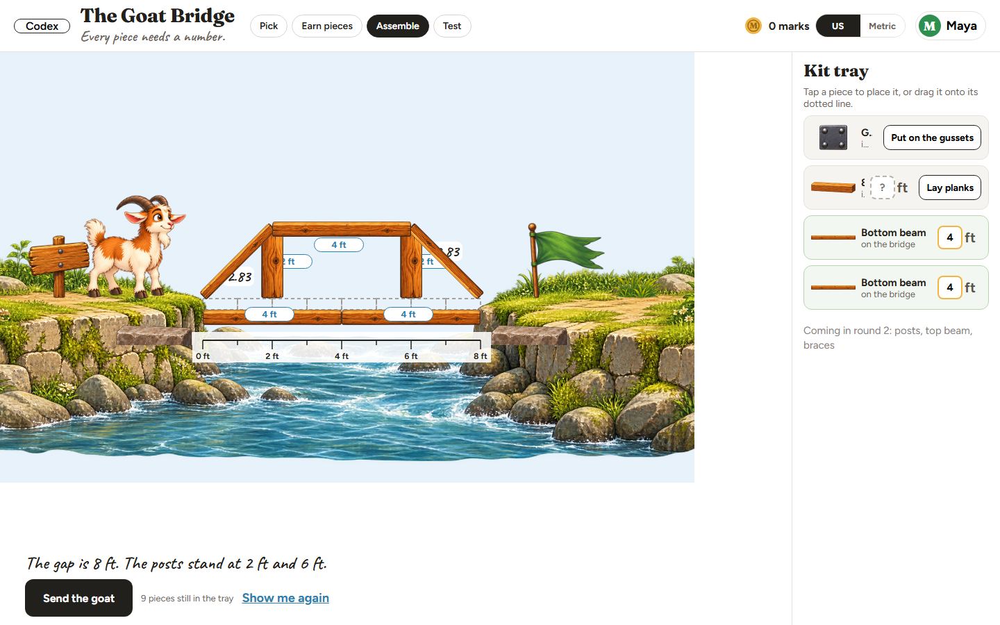
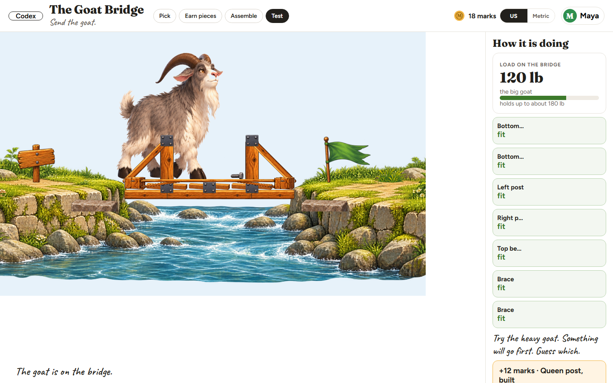

Math Builds: a K to 12 math app where kids earn the pieces of real machines by solving math, then build them and test them in a physics simulation.

  
  
  
  

## How it works

- Placement by strand
- 5 minute rounds that earn pieces
- Build and test with real physics
- Wrong numbers fail visibly
- Skill states with spaced review

## Built with

React, TypeScript, Vite, planck (Box2D physics), Canvas 2D, Vitest, about 600 tests.

## Live demo

LIVE_DEMO_URL

## Design docs

- [Curriculum](docs/curriculum.md)
- [Learning system](docs/learning-system.md)

## Author

Julie Mauerer, product design and direction; built by directing AI coding agents against her own spec and quality bar.
